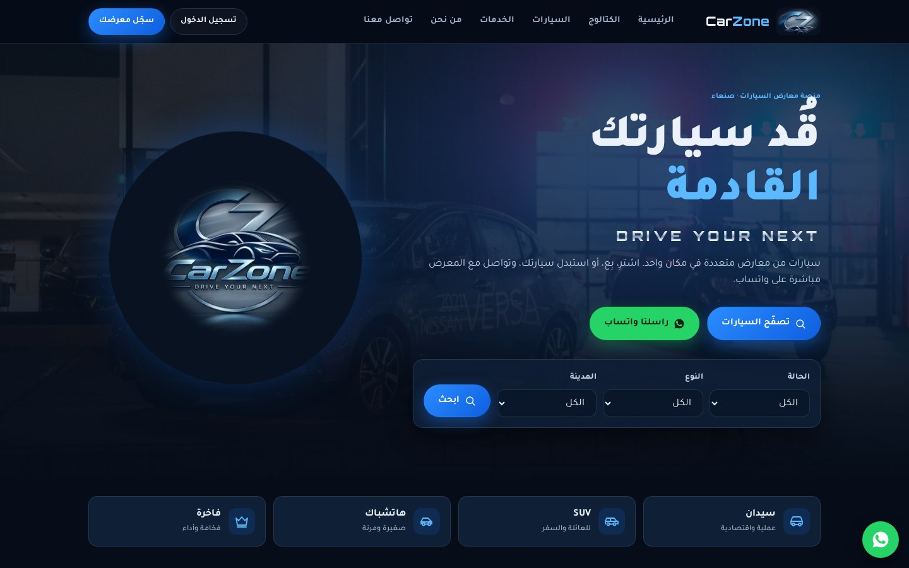
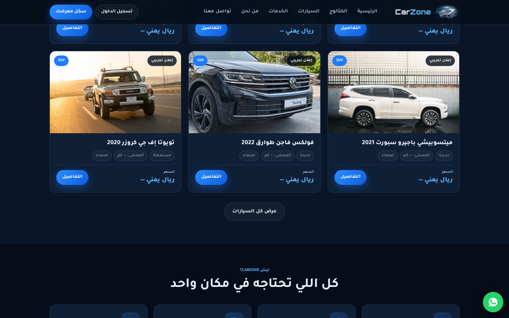
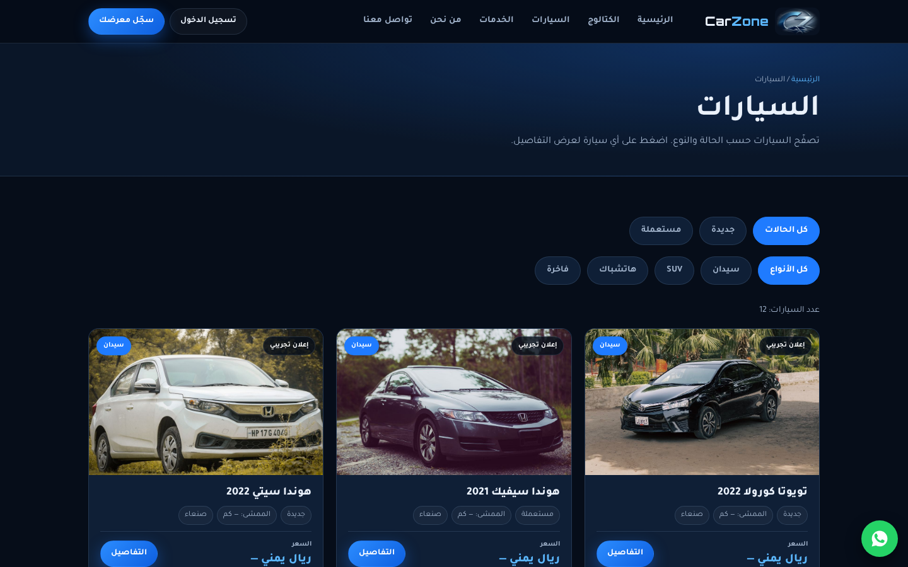
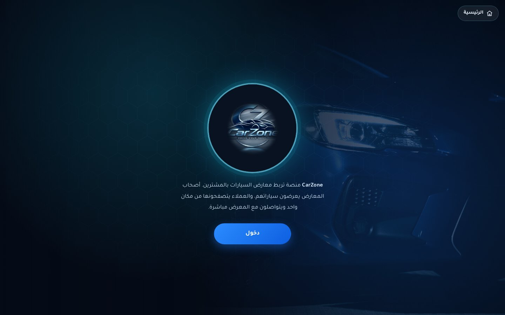
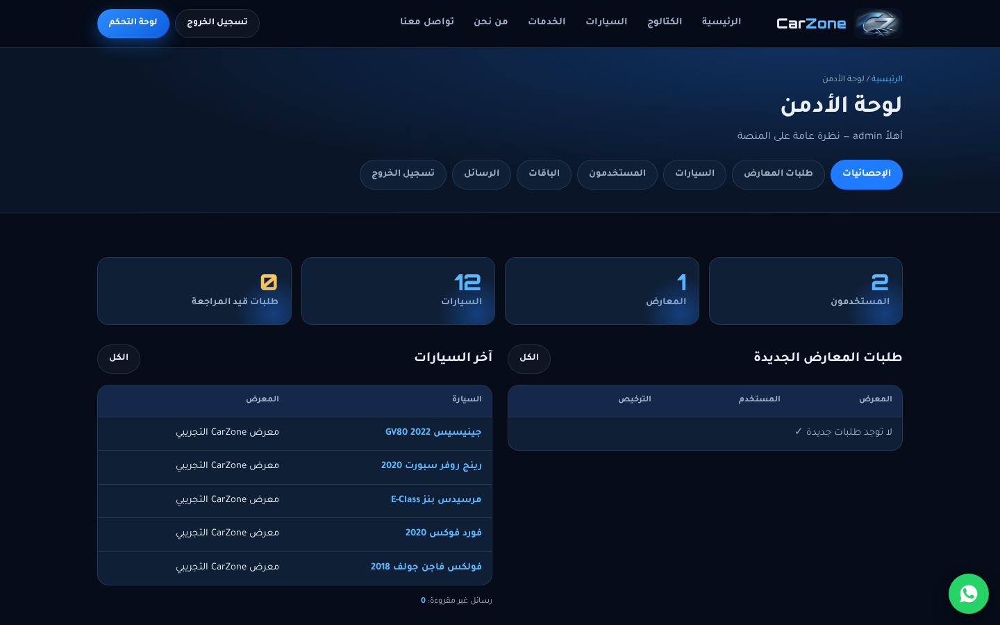
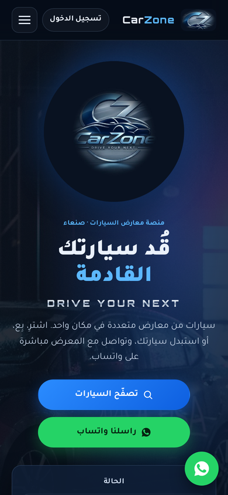

<h1 align="center">CarZone — Car Dealership Marketplace</h1>

<p align="center"><em>Drive Your Next · An Arabic (RTL) platform connecting car dealerships with buyers</em></p>

<p align="center">
  
  
  
  
  
</p>

<p align="center"></p>

## 📖 Overview

CarZone is an Arabic web platform that brings car dealerships and buyers together in one place. A dealer registers the showroom and uploads its license, the admin reviews and approves or rejects the request, and once approved the dealer lists cars with photos, price and specs. Customers browse the cars, filter them by condition (new / used) and body type (sedan, SUV, hatchback, luxury), open the details and contact the dealer directly by phone or WhatsApp. Prices are in Yemeni Rial. Built with plain PHP and MySQL — no framework — and runs directly on XAMPP.

## ✨ Features

- **Three roles** — customer, dealer and admin, plus guest browsing
- Customer **registration & login** (sessions, hashed passwords)
- **Dealer onboarding** — showroom info, license upload, subscription plan
- **Admin review** of dealers: approve / reject with license preview (`pending → approved / rejected`)
- Dealer dashboard to **add, edit and delete** their own cars with images
- **Car catalog** with filters by condition and body type, and a car details page
- Contact the dealer via **call or WhatsApp**
- **Admin panel** — stats, dealers, cars, users, plans and contact messages
- Contact form saved to the database
- CSRF protection and output escaping; uploads folder locked by `.htaccess`
- Fully Arabic, right-to-left, responsive UI

## 🛠️ Tech Stack

| Layer | Technology |
|---|---|
| Backend | PHP (no framework) |
| Database | MySQL / MariaDB — 6 tables: users, plans, dealers, cars, car_images, messages |
| Frontend | HTML5, CSS3, Vanilla JavaScript (RTL) |
| Local server | XAMPP (Apache + MySQL + phpMyAdmin) |

## 📸 Screenshots

**Home**


**Home Sections**



**Cars**



**Start**



**Admin Dashboard**



**Mobile**



## 🚀 Getting Started

**Requirements:** [XAMPP](https://www.apachefriends.org/) (Apache + MySQL + PHP).

1. Clone the repository into your XAMPP `htdocs` folder:
   ```bash
   cd C:\xampp\htdocs
   git clone https://github.com/Mo-aini/carzone-car-marketplace.git CarZone
   ```
2. Open the **XAMPP Control Panel** and start **Apache** and **MySQL**.
3. Open **phpMyAdmin** (`http://localhost/phpmyadmin`) → **Import** → choose `database.sql` → **Go**. This creates the `carzone` database with its tables and demo data.
4. If your MySQL credentials differ from the XAMPP defaults (`root`, no password), edit `config.php`.
5. Open `http://localhost/CarZone` in your browser.

**Demo accounts** (from `database.sql` — change them before any real deployment):

| Role | Username | Password |
|---|---|---|
| Admin | `admin` | `admin123` |
| Dealer | `demo_dealer` | `dealer123` |

Admin panel: `http://localhost/CarZone/admin/login.php`


## 📁 Project Structure

```
carzone-car-marketplace/
├── admin/
│   ├── .htaccess
│   ├── _guard.php
│   ├── _tabs.php
│   ├── cars.php
│   ├── dealers.php
│   ├── index.php
│   ├── login.php
│   ├── messages.php
│   ├── plans.php
│   └── users.php
├── dealer/
│   ├── .htaccess
│   ├── _tabs.php
│   ├── car-delete.php
│   ├── car-form.php
│   └── index.php
├── docs/
│   └── README-AR.txt
├── images/
│   └── … (27 files)
├── includes/
│   ├── .htaccess
│   ├── app-end.php
│   ├── dash-top.php
│   ├── footer.php
│   ├── functions.php
│   ├── head.php
│   └── header.php
├── screenshots/
│   └── … (6 files)
├── uploads/
│   ├── cars/
│   │   └── .gitkeep
│   ├── licenses/
│   │   └── .gitkeep
│   └── .htaccess
├── .gitignore
├── .htaccess
├── about.php
├── account-type.php
├── car-details.php
├── cars.php
├── catalog.php
├── config.php
├── contact.php
├── database.sql
├── db.php
├── dealer-info.php
├── dealer-license.php
├── dealer-login.php
├── dealer-subscribe.php
├── index.php
├── LICENSE
├── login.php
├── logout.php
├── README.md
├── register.php
├── script.js
├── services.php
├── start.php
└── style.css
```

## 📝 Notes

A detailed Arabic explanation of the project (users & roles, setup, database and pages) is in [`docs/README-AR.txt`](docs/README-AR.txt). User-uploaded images (`uploads/cars`, `uploads/licenses`) are not tracked in git.

---

<div dir="rtl">

## 🇾🇪 بالعربي

**CarZone** منصة ويب عربية تربط معارض السيارات بالمشترين في مكان واحد. صاحب المعرض يسجّل معرضه ويرفع صورة الترخيص، والأدمن يراجع الطلب ويقبله أو يرفضه. بعد القبول يضيف صاحب المعرض سياراته بالصور والسعر والمواصفات، والعميل يتصفح السيارات ويفلترها حسب الحالة (جديدة / مستعملة) والنوع، ويتواصل مع المعرض مباشرة بالاتصال أو الواتساب. الأسعار بالريال اليمني.

**التقنيات:** PHP و MySQL بدون Framework، وواجهة HTML و CSS و JavaScript من اليمين لليسار.

**التشغيل على جهازك:**
1. انسخ المجلد داخل `C:\xampp\htdocs\` باسم `CarZone`
2. شغّل Apache و MySQL من XAMPP
3. افتح phpMyAdmin واستورد ملف `database.sql`
4. افتح `localhost/CarZone`

**دخول الأدمن:** `admin` / `admin123` — **معرض تجريبي:** `demo_dealer` / `dealer123`

الشرح الكامل بالعربي في ملف `docs/README-AR.txt`.

</div>

---

## 👤 Author

**Mohammed Emad ALaini** — Software Engineering student & Full-Stack Developer

- Portfolio: [mohammedemad.netlify.app](https://mohammedemad.netlify.app/)
- GitHub: [@Mo-aini](https://github.com/Mo-aini)
- LinkedIn: [Mohammed Emad](https://www.linkedin.com/in/mohammed-emad-24a841373)

## 📄 License

This project is licensed under the [MIT License](LICENSE).
